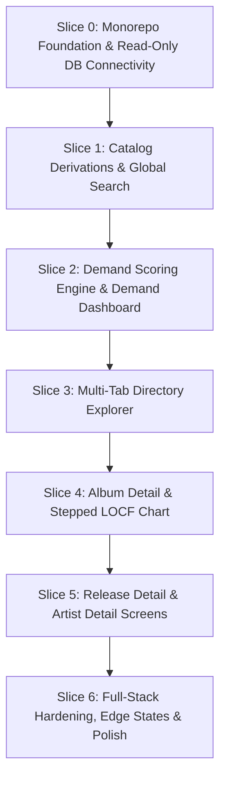

# Product Requirements Document (PRD): Vinyl Demand Intelligence Web Application

**Document Status**: Authoritative / Implementation-Ready  
**Reference Map**: [Map: Vinyl Demand Full-Stack Implementation Specification](https://github.com/Lolgend/vinyl-reddit-app/issues/6)  
**Parent Tickets**: [#7 (Database Derivations)](https://github.com/Lolgend/vinyl-reddit-app/issues/7), [#8 (Hype Scoring & Formulas)](https://github.com/Lolgend/vinyl-reddit-app/issues/8), [#9 (Stitch UI Reconciliation)](https://github.com/Lolgend/vinyl-reddit-app/issues/9), [#10 (Backend Stack & REST API Contract)](https://github.com/Lolgend/vinyl-reddit-app/issues/10)  
**Design System**: [DESIGN.md ("The Neo-Brutalist Ledger")](file:///C:/Users/ZPC/Desktop/Peak Labs/vinyl/app/DESIGN.md)  
**Domain Vocabulary**: [GLOSSARY.md](file:///C:/Users/ZPC/Desktop/Peak Labs/vinyl/app/GLOSSARY.md)  

---

## 1. Executive Summary & Product Architecture

### 1.1 Product Positioning & Problem Statement
Vinyl retail buyers and independent record store managers operate under compressed distributor pre-order windows and tight allocation quotas. Traditional procurement relies on subjective intuition or lagging sales reports, risking tied-up capital in dead stock or under-ordering viral pressings.

The **Vinyl Demand Intelligence Web Application** transforms live Reddit vinyl community momentum (`r/vinylreleases`) into an explainable, quantitative retail demand forecasting ledger. The application translates community upvotes, comment velocity, and multi-variant post discussions into standardized procurement indicators (`Hype Velocity`, `Hype Index (0–100)`, and stepped time-series curves), enabling commercial buyers to identify breakout pressings, evaluate catalog momentum, and make data-backed stocking decisions in seconds.

### 1.2 Full-Stack System Topology
The product operates as a tightly integrated two-tier monorepo architecture connecting a modern single-page frontend to a high-throughput Python API backend that executes strictly read-only queries against an existing PostgreSQL database populated by `reddit-scrape`:

```
+---------------------------------------------------------------------------------+
|                                 CLIENT TIER                                     |
|  Vite + React 19 + TypeScript + Tailwind CSS ("The Neo-Brutalist Ledger")       |
|  - React Router v7 (Declarative nested routing, URL window parameter sync)      |
|  - TanStack Query v5 (Server state caching, 30s stale time, background reval)   |
|  - Lucide React + Native SVG Monograms & Canvas-based LOCF Stepped Charts       |
+---------------------------------------------------------------------------------+
                                       |
                       HTTP / REST JSON (/api/v1)
                                       v
+---------------------------------------------------------------------------------+
|                                 BACKEND TIER                                    |
|  FastAPI (Python 3.10+ / uv) running on Uvicorn worker pool                     |
|  - Starlette synchronous threadpool worker execution model                      |
|  - Local path dependency: reddit-scrape = { path = "../reddit-scrape" }         |
|  - Deep Service Seams: catalog, hype, timeseries, search                        |
|  - Read-Only SQLAlchemy Engine (postgresql_readonly=True, autocommit=False)     |
+---------------------------------------------------------------------------------+
                                       |
                       Read-Only Synchronous SQL Queries
                                       v
+---------------------------------------------------------------------------------+
|                             DATA TIER (SHARED)                                  |
|  PostgreSQL 16 + pgvector Database (Managed & populated by ../reddit-scrape)    |
|  - submissions, submission_snapshots, releases, artists, release_artists, ...   |
|  - Invariant: App performs zero schema migrations, DDL, or table writes         |
+---------------------------------------------------------------------------------+
```

### 1.3 Scope Boundaries & Explicit Non-Goals
To protect engineering velocity and ensure strict adherence to factual database capabilities, the following features and UI chrome are locked as **Out of Scope** across all screens and endpoints:

1. **Unbacked Retail & Catalog Fields**: Price / MSRP (`$35–$72`), "Discogs Price Pulse", physical inventory/stock counts & pressing run sizes (`"1 In Stock / 4 Sold Out"`, `"Ltd / ~25,000"`, `"28 SKUs"`, stock ratio bars), UPC codes, Record Label / Imprint chips, First Released year, Discogs indexing status, DMM/audiophile master badges, and Reddit submission `author` (`u/...`, dropped in scraper ADR 0001).
2. **Retired Event Classifications & Flags**: `Release Event` (`NEW RELEASE`, `PRE-ORDER`, `RESTOCK`, `REPRESS`, `SOLD OUT`) and `submissions.flair` are retired from the UI and backend; catalog availability KPI cards (`ACTIVE AVAILABILITY`, `CATALOG AVAILABILITY`) are completely removed.
3. **Fabricated Telemetry & Marketing Chrome**: Header/footer cluster statistics (`"14 Scraping Clusters"`, `"42 DTC APIs"`, `"LIVE WEBSOCKET"`, `"99.8% Accuracy"`, `"SHA-256 hash valid"`, `"Raw JSON Payload"`).
4. **Auth, User State & Export Functions**: User accounts, login, roles, notification bells, watchlists (`+ Track Release`, `+ Watch Album`), alerts, and CSV exports (`Export Ledger`).
5. **Unbuilt Navigation Destinations**: Standalone `Hype Board`, `Retailers`, `Watchlist Alerts`, `Docs / Reddit & API Feeds`, and `System Settings` pages. Primary navigation is scoped strictly to `Demand Dashboard` (`/dashboard`) and `Directory Explorer` (`/directory`).
6. **External Image Fetching**: Calling external APIs (Discogs, Spotify, MusicBrainz) or web scraping for album artwork. Artwork is replaced entirely by deterministic Neo-Brutalist monogram placeholders.
7. **Cloud Infrastructure**: Cloud provisioning, container orchestration, and remote deployment. The product is designed for local developer and workstation execution.

---

## 2. Read-Only Database Derivations & Entity Identity

### 2.1 Database Ownership & Read-Only Safety Invariants
The web application connects directly to the PostgreSQL database populated by `reddit-scrape`. The backend enforces strict read-only execution:
- **Zero Schema Migrations**: The application defines no Alembic migrations or DDL operations against scraper tables.
- **Connection-Level Safety**: The SQLAlchemy engine is configured with:
  ```python
  engine = create_engine(
      settings.DATABASE_URL,
      pool_pre_ping=True,
      execution_options={"postgresql_readonly": True},
      connect_args={"options": "-c default_transaction_read_only=on"}
  )
  ```
- **Declarative Model Reuse**: Rather than duplicating ORM declarations, `backend/pyproject.toml` references `reddit-scrape` as a local path dependency (`reddit-scrape = { path = "../reddit-scrape" }`), directly importing `Submission`, `SubmissionSnapshot`, `Release`, `Artist`, `ReleaseArtist`, and `SubmissionRelease`.

### 2.2 Canonical `Album` Identity & `album_id` Derivation
Because the `reddit-scrape` database normalizes physical pressings (`releases`) rather than higher-level musical works, `Album` identity is dynamically derived by grouping physical releases:

1. **SQL Attribute Normalization**:
   String normalization mirrors `reddit_scrape.persistence.normalize_attribute`:
   ```sql
   LOWER(TRIM(REGEXP_REPLACE(REGEXP_REPLACE(col, '[\u2010-\u2015\u2212]', '-', 'g'), '\s+', ' ', 'g')))
   ```
2. **Canonical Display Casing**:
   Display values for `combined_artist` and `album_title` are deterministically extracted from the earliest-ingested child `Release` in the group:
   ```sql
   ORDER BY releases.created_at ASC, releases.id ASC LIMIT 1
   ```
3. **Deterministic `album_id` / URL Key**:
   The unique key for routing and API retrieval is the first 16 lowercase hexadecimal characters of `sha256("{norm_artist}|{norm_album}")`:
   ```python
   album_id = hashlib.sha256(f"{norm_artist}|{norm_album}".encode("utf-8")).hexdigest()[:16]
   ```
   In PostgreSQL SQL queries:
   ```sql
   SUBSTRING(ENCODE(DIGEST(norm_artist || '|' || norm_album, 'sha256'), 'hex') FROM 1 FOR 16) AS album_id
   ```

### 2.3 `Artist` Attribution: Solo vs. `Combined Artist` Classification
Individual artists are keyed by `artists.id` (UUID) and linked to releases via `release_artists(release_id, artist_id)`:
- **Solo Appearance**:
  `normalize_attribute(artists.name) == norm_artist` AND the `Release` has exactly 1 linked `Artist` in `release_artists`.
- **`Combined Artist` Appearance**:
  `normalize_attribute(artists.name) != norm_artist` OR `COUNT(DISTINCT release_artists.artist_id) > 1` (e.g. split releases, collaborative billings such as `Converge / Dropdead` or `Kanye West & Ty Dolla $ign`).
- **Catalog Footprint**:
  An artist's catalog count is cleanly segmented into `solo_album_count` and `combined_album_count`, with `album_count = solo_album_count + combined_album_count`.

### 2.4 Deduplicated `Submission` Union Rollups
When an album or artist has multiple variants or pressings announced across several Reddit submissions, naive summation causes multi-variant or split-release posts to be counted multiple times.
- **Aggregation Invariant**: All entity-level engagement aggregates (`submission_count`, total `score`, total `num_comments`, `Hype Velocity`, and `Hype Index`) aggregate across the **distinct union of release submissions**:
  ```sql
  WHERE submissions.is_release = TRUE
  GROUP BY ... COUNT(DISTINCT submission_releases.submission_id)
  ```
- **Factual Structural Counts**:
  - `release_count`: `COUNT(DISTINCT releases.id)`
  - `submission_count`: `COUNT(DISTINCT submission_releases.submission_id)`
  - `album_count`: `COUNT(DISTINCT derived_album_id)`

### 2.5 Nullable `Variant` and `Retailer` Fallbacks
- **API Serializer**: Return `variant: str | None` and `retailer_name: str | None` (`null` when unspecified, converting any literal string `"[standard]"` to `null`).
- **UI Fallbacks**:
  - `variant == null` renders as `"Standard Pressing"` (bordered chip).
  - `retailer_name == null` renders as `"Wide / Unspecified"` (subdued font).
- **Facet Filters**: Exclude `NULL` values from `Directory Explorer` retailer filter chips to avoid cluttering options with undefined records.

---

## 3. Mathematical Scoring & Aggregation Engine

### 3.1 `Hype Window` Parameterization
Demand calculations operate across three user-selectable historical windows ($W \in \{24\text{H}, 7\text{D}, 1\text{M}\}$):

| Parameter | $24\text{H}$ Window | $7\text{D}$ Window | $1\text{M}$ ($30\text{D}$) Window |
|---|---|---|---|
| **SQL Interval** | `INTERVAL '24 hours'` | `INTERVAL '7 days'` | `INTERVAL '30 days'` |
| **Cutoff Timestamp ($t_0$)** | $\text{NOW}() - 24\text{h}$ | $\text{NOW}() - 7\text{d}$ | $\text{NOW}() - 30\text{d}$ |
| **Freshness Half-Life ($\tau_W$)** | $12.0\text{ hours}$ | $72.0\text{ hours}$ ($3\text{ days}$) | $336.0\text{ hours}$ ($14\text{ days}$) |
| **Chart Buckets ($N \times \text{step}$)** | $24 \times 1\text{ hour}$ | $28 \times 6\text{ hours}$ | $30 \times 1\text{ day}$ |

### 3.2 Composite Engagement Points ($E$)
Reddit submissions capture community interest through both upvotes and discussions:
$$E = \text{score} + 2 \cdot \text{num\_comments}$$

### 3.3 Window Engagement Gain ($\Delta E_s$) & Single-Snapshot Origin Anchor
For each release-eligible submission $s$ (`s.is_release = TRUE`):
1. Let $S_{\text{latest}}$ be the latest snapshot in `submission_snapshots` for $s$ with $\text{captured\_at} \ge t_0$. If no snapshot exists in $[t_0, \text{NOW}()]$, then $\Delta E_s(W) = 0$ and $v_s(W) = 0.0$.
2. **Baseline Determination $(E_{\text{base}}, t_{\text{base}})$**:
   - **Submission Created Inside Window ($s.\text{created\_utc} \ge t_0$)**: Anchor to post origin:
     $$E_{\text{base}} = 0, \quad t_{\text{base}} = s.\text{created\_utc}$$
     *Critical Invariant*: Prevents freshly ingested posts with only 1 snapshot from evaluating to 0 gain; captures immediate launch velocity.
   - **Submission Created Before Window ($s.\text{created\_utc} < t_0$)**: Anchor to the latest snapshot captured at or before $t_0$ (`captured_at <= t0 ORDER BY captured_at DESC LIMIT 1`). If unobserved prior to $t_0$ (e.g. retention purge), fall back to earliest snapshot inside $[t_0, \text{NOW}()]$.
3. **Net Window Gain**:
   $$\Delta E_s(W) = \max(0, E(S_{\text{latest}}) - E_{\text{base}})$$

### 3.4 `Hype Velocity` ($V_{\text{entity}}$)
1. **Per-Submission Elapsed Hours ($\Delta t_s$)**:
   $$\Delta t_s = \max\left(0.25, \frac{\text{epoch}(\text{NOW}() - t_{\text{base}})}{3600.0}\right)$$
   *15-Minute Floor*: Measures elapsed time up to $\text{NOW}()$ rather than the last snapshot timestamp. Ensures that velocity naturally cools down when a post stops generating engagement, rather than freezing at an obsolete burst rate.
2. **Per-Submission Velocity ($v_s$)**:
   $$v_s = \text{round}\left(\frac{\Delta E_s}{\Delta t_s}, 1\right)$$
3. **Entity Rollup ($V_{\text{entity}}$)**:
   Summed across the deduplicated union of linked submissions $U$:
   $$V_{\text{entity}} = \text{round}\left(\sum_{s \in U} v_s, 1\right)$$
4. **Standardized Metric Label**:
   All hero cards, directory tables, and comparisons standardize on `HYPE VELOCITY` (`+X.X pts/hr`), completely retiring the legacy `PEAK HYPE VELOCITY` label.

### 3.5 `Hype Index` ($0–100$) Formulation
1. **Upvote Quality Multiplier ($q_s$)**:
   $$q_s = 0.5 + 0.5 \cdot r_s \in [0.5, 1.0], \quad \text{where } r_s = \text{COALESCE}(s.\text{latest\_upvote\_ratio}, 1.0)$$
2. **Window-Scaled Exponential Decay ($\text{decay}_s$)**:
   $$a_s = \max\left(0.0, \frac{\text{epoch}(\text{NOW}() - s.\text{created\_utc})}{3600.0}\right), \quad \text{decay}_s = 2^{-a_s / \tau_W}$$
3. **Raw Submission Signal ($h_s$)**:
   $$h_s = \left(v_s + \frac{\Delta E_s}{\tau_W}\right) \cdot q_s \cdot 2^{-a_s / \tau_W}$$
4. **Entity Raw Hype ($H_{\text{entity}}$)**:
   $$H_{\text{entity}} = \sum_{s \in U} h_s$$
5. **Log-Compressed Cohort Normalization with Reference Floor ($H_{\text{floor}} = 25.0$)**:
   Within each entity class (`Release`, `Album`, or `Artist`) across window $W$:
   $$\text{HypeIndex} = \min\left(100, \text{round}\left(100.0 \cdot \frac{\ln(1.0 + H_{\text{entity}})}{\max\left(\max_e \ln(1.0 + H_e), \ln(1.0 + 25.0)\right)}\right)\right)$$
   - Entities with $H_{\text{entity}} = 0$ evaluate to `0`.
   - The reference floor $H_{\text{floor}} = 25.0$ ensures that quiet windows with minimal activity do not artificially inflate low-traction posts into the top tier.
6. **Canonical Visual Tiers (`DESIGN.md`)**:
   - **High Hype ($75–100$)**: Mint `#68D391`
   - **Moderate Hype ($40–74$)**: Amber `#ECC94B`
   - **Low / Cooling Hype ($0–39$)**: Subdued Ink `#646464`

### 3.6 Stepped Time-Series Aggregation (LOCF Engine)
Time-series charts on `Album Detail` and `Release Detail` render stepped cumulative engagement points and interval velocities using Last Observation Carried Forward (LOCF) semantics:
1. **Uniform Boundary Grid**: Generate $N+1$ timestamps $b_0, b_1, \dots, b_N$ ending at $\text{NOW}()$ using `generate_series`.
2. **LOCF Boundary Sampling**: For each linked submission $s$ and boundary $b_i$:
   - If $b_i < s.\text{created\_utc}$: $E(b_i) = 0$.
   - If $b_i \ge s.\text{created\_utc}$: Select latest snapshot with $\text{captured\_at} \le b_i$.
   - If snapshots are older than 30 days (purged by retention), carry forward $s.\text{latest\_score}$ and $s.\text{latest\_num\_comments}$.
3. **Bucket Stepped Velocity**:
   For each interval $i \in [1, N]$ with bucket width $w_{\text{hrs}}$ ($1\text{h}$, $6\text{h}$, or $24\text{h}$):
   $$v_{\text{bucket}}(i) = \text{round}\left(\frac{\max(0, E(b_i) - E(b_{i-1}))}{w_{\text{hrs}}}, 1\right)$$

### 3.7 `Album Detail` Child-`Release` Share-of-Demand
On `Album Detail`, the relative commercial traction of each variant/pressing is computed from its total engagement points:
$$E_r = \sum_{s \in U(r)} (s.\text{latest\_score} + 2 \cdot s.\text{latest\_num\_comments})$$
$$\text{share}(r) = \begin{cases} \text{round}\left(100.0 \cdot \dfrac{E_r}{\sum_{j=1}^K E_j}, 1\right) & \text{if } \sum E_j > 0 \\ \text{round}\left(\dfrac{100.0}{K}, 1\right) & \text{otherwise} \end{cases}$$

---

## 4. Backend Architecture & REST API Contract

### 4.1 Internal Module Organization
```
backend/
├── pyproject.toml              # FastAPI, Pydantic v2, Uvicorn, path dep on ../reddit-scrape
├── src/
│   └── backend/
│       ├── __init__.py
│       ├── main.py             # FastAPI app factory, CORS, exception handlers, route mounts
│       ├── config.py           # Pydantic BaseSettings, DATABASE_URL resolution
│       ├── db.py               # Read-only SQLAlchemy engine, sessionmaker, get_db dependency
│       ├── schemas/            # Pydantic v2 serialization contracts
│       │   ├── common.py       # HypeWindow, PaginationMeta, TimeSeriesBucket, ErrorResponse
│       │   ├── dashboard.py    # DemandDashboardResponse, LeaderboardCard, LiveFeedItem
│       │   ├── directory.py    # DirectoryReleaseItem, DirectoryAlbumItem, DirectoryArtistItem
│       │   ├── album.py        # AlbumDetailResponse, ShareOfDemandItem, ChildReleaseRow
│       │   ├── release.py      # ReleaseDetailResponse, PhysicalSpecCard, SubmissionRow
│       │   ├── artist.py       # ArtistDetailResponse, TrackedAlbumRow, ChildReleaseRow
│       │   └── search.py       # QuickSearchResponse, SearchResultGroup
│       ├── services/           # Deep domain logic isolating SQL queries
│       │   ├── catalog.py      # Album ID SHA-256 derivation, casing, Solo vs Combined
│       │   ├── hype.py         # Points, baseline anchor, velocity, index, decay, normalization
│       │   ├── timeseries.py   # generate_series LOCF boundary calculation
│       │   └── search.py       # Multi-entity substring search
│       └── routes/             # Thin FastAPI endpoint routers
│           ├── dashboard.py    # GET /api/v1/dashboard
│           ├── directory.py    # GET /api/v1/directory/{releases|albums|artists}
│           ├── entities.py     # GET /api/v1/{albums|releases|artists}/{id}
│           └── search.py       # GET /api/v1/search
└── tests/                      # Automated test suite
```

### 4.2 Endpoint Specifications (`/api/v1`)

#### 1. `GET /api/v1/dashboard`
Returns top leaderboards and live release feed data for the `Demand Dashboard`.
- **Query Parameters**:
  - `window`: `HypeWindow` enum (`24H` default, `7D`, `1M`).
- **Response Schema (`DemandDashboardResponse`)**:
  ```json
  {
    "provenance": {
      "source": "r/vinylreleases",
      "last_snapshot_at": "2026-10-31T13:15:00Z"
    },
    "leaderboards": {
      "top_albums": [
        {
          "rank": 1,
          "album_id": "9b6dff12a4c8e0da",
          "album_title": "Titanic Rising",
          "combined_artist": "Weyes Blood",
          "hype_index": 94,
          "hype_velocity": 18.4,
          "submission_count": 3,
          "release_count": 2
        }
      ],
      "top_releases": [
        {
          "rank": 1,
          "release_id": "3fa85f64-5717-4562-b3fc-2c963f66afa6",
          "album_id": "9b6dff12a4c8e0da",
          "album_title": "Titanic Rising",
          "combined_artist": "Weyes Blood",
          "variant": "Maroon Galaxy Vinyl",
          "retailer_name": "Rough Trade",
          "hype_index": 94,
          "hype_velocity": 14.2
        }
      ],
      "newly_added": [
        {
          "first_seen_at": "2026-10-31T12:55:00Z",
          "release_id": "a1b2c3d4-e5f6-7890-1234-56789abcdef0",
          "album_id": "68d39100deadbeef",
          "album_title": "Glow On",
          "combined_artist": "Turnstile",
          "variant": "Cloudy Clear / 500",
          "retailer_name": "Bandcamp",
          "hype_index": 78,
          "latest_score": 42,
          "hype_velocity": 8.5
        }
      ]
    },
    "live_feed": [
      {
        "release_id": "3fa85f64-5717-4562-b3fc-2c963f66afa6",
        "album_id": "9b6dff12a4c8e0da",
        "album_title": "Titanic Rising",
        "combined_artist": "Weyes Blood",
        "artists": [{"artist_id": "...", "name": "Weyes Blood"}],
        "variant": "Maroon Galaxy Vinyl",
        "retailer_name": "Rough Trade",
        "hype_index": 94,
        "hype_velocity": 14.2,
        "total_score": 182,
        "total_comments": 47,
        "submission_count": 2,
        "latest_submission_at": "2026-10-31T12:30:00Z"
      }
    ]
  }
  ```

#### 2. `GET /api/v1/directory/releases`
Paginated directory of physical releases across the entire catalog.
- **Query Parameters**:
  - `window`: `HypeWindow` enum (`24H` default, `7D`, `1M`).
  - `q`: Search substring filter (optional).
  - `retailer`: Exact retailer filter (optional).
  - `sort_by`: `hype_index` (default), `hype_velocity`, `submissions`, `created_at`.
  - `sort_order`: `desc` (default), `asc`.
  - `page`: Integer $\ge 1$ (default `1`).
  - `page_size`: Integer $1..100$ (default `25`).
- **Response**: Items array with `DirectoryReleaseItem` + `PaginationMeta`.

#### 3. `GET /api/v1/directory/albums`
Paginated directory of derived albums.
- **Query Parameters**: Same common pagination and search parameters; `attribution` filter (`all` default, `solo`, `combined`).
- **Response**: Items array with `DirectoryAlbumItem` (includes `release_count`, preview variants, distinct retailer list) + `PaginationMeta`.

#### 4. `GET /api/v1/directory/artists`
Paginated directory of individual artists.
- **Query Parameters**: Same common pagination and search parameters; `attribution` filter (`all` default, `solo`, `combined`).
- **Response**: Items array with `DirectoryArtistItem` (includes `solo_album_count`, `combined_album_count`, `release_count`) + `PaginationMeta`.

#### 5. `GET /api/v1/albums/{album_id}`
Compound response for `Album Detail`.
- **Query Parameters**: `window`: `HypeWindow` enum (`24H` default, `7D`, `1M`).
- **Response Schema (`AlbumDetailResponse`)**:
  - `album`: Identity, display casing, artist links, `first_seen_at`, `last_seen_at`.
  - `hero_kpi`: `hype_index`, `hype_velocity`, `reddit_demand` (`points_gain`, `total_score`, `total_comments`), `provenance` (`release_count`, `submission_count`, `last_seen_relative`).
  - `time_series`: Uniform stepped buckets (`bucket_start`, `bucket_end`, `cumulative_points`, `velocity_pts_per_hr`).
  - `submission_markers`: Linked submission events ($t_{\text{created}}$, title, id).
  - `share_of_demand`: List of child releases with `share_percentage` and total points.
  - `child_releases`: 7-column matrix rows.

#### 6. `GET /api/v1/releases/{release_id}`
Compound response for `Release Detail`.
- **Query Parameters**: `window`: `HypeWindow` enum (`24H` default, `7D`, `1M`).
- **Response Schema (`ReleaseDetailResponse`)**:
  - `release`: Physical spec metadata (`variant`, `retailer_name`, `created_at`, `parent_album`).
  - `hero_kpi`: `hype_index`, `hype_velocity`, `engagement` (`score`, `upvote_ratio`, `num_comments`), `provenance` (`submission_count`, `first_seen`, `last_seen`).
  - `time_series`: Stepped snapshot curve over window $W$.
  - `submissions`: 6-column list of linked Reddit submissions (`id`, `title`, `url`, `created_utc`, `latest_score`, `latest_upvote_ratio`, `latest_num_comments`, `window_velocity`).

#### 7. `GET /api/v1/artists/{artist_id}`
Compound response for `Artist Detail`.
- **Query Parameters**: `window`: `HypeWindow` enum (`24H` default, `7D`, `1M`).
- **Response Schema (`ArtistDetailResponse`)**:
  - `artist`: Identity (`artists.name`, `created_at`, `last_seen_at`).
  - `hero_kpi`: `hype_index`, `hype_velocity`, `catalog_footprint` (`album_count`, `solo_album_count`, `combined_album_count`, `release_count`), `reddit_demand`.
  - `tracked_albums`: 7-column matrix rows with Solo vs. Combined badges.
  - `child_releases`: 7-column ledger rows of all releases associated with this artist.

#### 8. `GET /api/v1/search`
Quick substring typeahead search for top bar global search input.
- **Query Parameters**: `q` (string, min 2 chars), `limit` (int, default 5 per entity type).
- **Response Schema (`QuickSearchResponse`)**: Grouped results: `albums`, `releases`, `artists`.

---

## 5. Frontend System Architecture & Reconciled 5-Screen UI

### 5.1 Design System Tokens & Spatial Architecture
The frontend strictly adheres to **The Neo-Brutalist Ledger** ([DESIGN.md](file:///C:/Users/ZPC/Desktop/Peak Labs/vinyl/app/DESIGN.md)):
- **Tonal Surfaces**: Canvas `#F7F3F0`, Nav Rail `#0E0E10`, Cards `#FFFFFF`, Row Hover `#FAF7F5`.
- **Structural Ink**: `#121212` for all `1.5px solid` structural borders (`border-strong`), drop shadows, and active filter pill fills. Hairline `#E5E0DA` (`1px solid`) for internal table dividers.
- **Brutalist Shadows**: Hard offset geometric scale: `0px` (active/flat), `2px 2px 0px #121212` (buttons/inputs), `3px 3px 0px #121212` (cards/modals). Zero blur gradients.
- **Typography**:
  - Headlines: `Space Grotesk` (`700` weight)
  - Interface & Body: `Inter` (`400`/`500` weight)
  - Numerics & Metrics: `JetBrains Mono` (`font-variant-numeric: tabular-nums`)
- **Deterministic Monogram Engine**:
  2-character uppercase initials over a concentric vinyl groove SVG ring, deterministically styled by hashing the entity key modulo the 5-color Neo-Brutalist palette (`#9B6DFF`, `#68D391`, `#ECC94B`, `#E5E0DA`, `#FFFFFF`).

### 5.2 Application Shell (`AppShell.tsx`)
1. **Left Navigation Rail (`240px` fixed width, `#0E0E10`)**:
   - Brand block: Vinyl monogram + `VINYL DEMAND` (`Space Grotesk`) + `r/vinylreleases LEDGER` (`JetBrains Mono`).
   - Primary navigation (`INTELLIGENCE`):
     - `Demand Dashboard` (`/dashboard`)
     - `Directory Explorer` (`/directory`) with nested quick-links: `Releases` (`/directory?tab=releases`), `Albums` (`/directory?tab=albums`), `Artists` (`/directory?tab=artists`).
   - Provenance footer: `SOURCE: r/vinylreleases` (`JetBrains Mono` `11px` `#646464`). Zero auth or telemetry claims.
2. **Top Workspace Search & Provenance Bar (`64px` height, `1.5px solid #121212` bottom border)**:
   - Left: Global Search Input with `[⌘K]` shortcut badge and `CLEAR` button.
     - On `Directory Explorer`, binds directly to `?q=<query>`.
     - On other screens, submitting navigates to `/directory?q=<query>`.
   - Right: Factual database freshness badge: `SOURCE: r/vinylreleases · LAST SNAPSHOT: <rel_time>`.
3. **URL State Synchronization**:
   - Active `Hype Window` parameter (`?window=24H|7D|1M`) is synchronized to URL query parameters across all routes and preserved across internal navigation links.

### 5.3 Screen-by-Screen Layout & Ledger Schemas

#### 1. `Demand Dashboard` (`/dashboard`)
- **Top Row (12 columns)**: 3 equal-width 4-column leaderboard cards (uniform 5-row height):
  1. *Top Albums*: Rank badge (`#1`–`#5`), clickable artist/album title, tier-colored `Hype Index` badge, deduplicated post counts, and `Hype Velocity` + progress bar. Independent `24H | 7D | 1M` switcher.
  2. *Top Releases*: Rank badge, clickable title, tier-colored `Hype Index`, `Variant · Retailer` subtitle, and `Hype Velocity`. Independent `24H | 7D | 1M` switcher.
  3. *Newly Added Releases*: Relative first-seen timestamp badge (`12m ago`), clickable title, `24H` `Hype Index`, and latest score + velocity. Fixed to `24H` window.
- **Bottom Row (12 columns)**: `Live Release Feed` full-width 7-column ledger table:
  1. `Combined Artist & Album` (monogram + clickable title + artist links)
  2. `Variant` (bordered chip, `"Standard Pressing"` fallback)
  3. `Retailer` (`"Wide / Unspecified"` fallback)
  4. `Hype Index` (`0–100` tier pill + bar)
  5. `Hype Velocity` (`+X.X pts/hr`)
  6. `Submission Metrics` (`score` pts · `num_comments` comments · `submission_count` posts)
  7. `Action` (`View Release →`)

#### 2. `Directory Explorer` (`/directory`)
- **Header & Segmented Tabs**: `Directory Explorer` headline + tab switcher with live entity counts: `Releases (N)`, `Albums (M)`, `Artists (K)`.
- **Shared Command Bar**: Governed by top bar search (`?q=`), shared `Hype Window` pill switcher (`24H | 7D | 1M`), `Hype Index` tier chips (`All`, `High`, `Mod`, `Low`), non-null `Retailer` chips, `Sort` dropdown, and `Grid | Table` toggle on Releases tab.
- **Tab 1: Releases**:
  - *Grid View*: 3-column card grid with monogram, title, tier badge, variant/retailer chips, metrics block, and dual action buttons (`View Release →`, `Album (M Releases)`).
  - *Table View*: 7-column ledger table matching `Live Release Feed`.
- **Tab 2: Albums**:
  - 7-column table: `Album & Combined Artist`, `Child Releases` (`release_count` + variant preview), `Retailers`, `Submissions` (deduplicated union), `Hype Velocity`, `Hype Index`, `Action` (`View Album →`).
- **Tab 3: Artists**:
  - 7-column table: `Artist` (monogram + name), `Tracked Albums` (`album_count`: `solo_album_count` Solo / `combined_album_count` Combined), `Child Releases`, `Submissions`, `Hype Velocity`, `Hype Index`, `Action` (`View Artist →`).

#### 3. `Album Detail` (`/albums/:albumId`)
- **Top Header**: Back link (`← Back to Directory`), 64px monogram, H1 `Space Grotesk` title, relationship chips + top-level **`LAST SEEN: <relative_time> (<YYYY-MM-DD>)`**, and page-level `Hype Window` pill switcher.
- **4-Cell Hero KPI Strip**:
  1. `HYPE INDEX` (`0–100` badge + bar)
  2. `HYPE VELOCITY` (`+X.X pts/hr`)
  3. `REDDIT DEMAND` (`+ΔE` window gain · total `score` · `num_comments`)
  4. `PRESSINGS & PROVENANCE` (`release_count` Child Releases · `submission_count` Deduplicated Posts · `Last Seen`)
- **Middle Row (12 columns)**:
  - 8-col **Stepped `Hype Velocity` & Cumulative Points Chart**: Stepped LOCF curve with dashed vertical markers for linked submission $t_{\text{created}}$ events.
  - 4-col **Child-`Release` Share-of-Demand Card**: Horizontal percentage share bars (`share(r)%`).
- **Bottom Row (12 columns)**: 7-column child releases matrix (`Variant`, `Retailer`, `Share of Demand`, `Submissions`, `Hype Velocity`, `Hype Index`, `Action`).

#### 4. `Release Detail` (`/releases/:releaseId`)
- **Top Header**: Back link, monogram, H1, relationship links, top-level `LAST SEEN`, and window pill switcher.
- **4-Cell Hero KPI Strip**:
  1. `HYPE INDEX`
  2. `HYPE VELOCITY`
  3. `SUBMISSION ENGAGEMENT` (total `score` · `upvote_ratio%` · total `num_comments`)
  4. `PROVENANCE SUMMARY` (`submission_count` · `Last Seen` · `First Seen`)
- **Middle Row (12 columns)**:
  - 5-col **Physical Specification Card**: Artist links, parent album link (`View Album (N Releases) →`), variant, retailer, first/last seen dates, linked submission count.
  - 7-col **Stepped Snapshot Engagement Chart**: Stepped LOCF points curve over window $W$.
- **Bottom Row (12 columns)**: 6-column `r/vinylreleases` submission provenance table (`Submission Title & ID` with `t3_...` badge, `Posted`, `Score & Ratio`, `Comments`, `Window Velocity`, `Source Link` to Reddit URL).

#### 5. `Artist Detail` (`/artists/:artistId`)
- **Top Header**: Back link, monogram, H1, top-level `LAST SEEN`, and window pill switcher.
- **4-Cell Hero KPI Strip**:
  1. `HYPE INDEX`
  2. `HYPE VELOCITY`
  3. `CATALOG FOOTPRINT` (`album_count` Total: `solo_album_count` Solo / `combined_album_count` Combined · `release_count` Releases)
  4. `REDDIT DEMAND` (`submission_count` Posts · total `score` · `num_comments` · `Last Seen`)
- **Middle Row (12 columns)**: 7-column Tracked Albums & Combined Appearances matrix (`Album`, `Billing Attribution` with `Solo` vs `Combined: ...` badge, `Child Releases`, `Submissions`, `Hype Velocity`, `Hype Index`, `Action`).
- **Bottom Row (12 columns)**: 7-column Child Releases ledger table across all catalog pressings.

### 5.4 Edge States, Loading & Error Handling
- **Zero Window Activity**: Render `0 / 100` in Low Tier (`#646464`, empty `#E5E0DA` bar) and `0.0 pts/hr`. Detail charts render a flat LOCF baseline with mono banner: `NO NEW ACTIVITY IN <W> — LAST SEEN <REL_TIME>`.
- **Partial Leaderboards (`< 5` Active Rows)**: Pad remaining slots up to 5 with subdued dashed placeholder rows to maintain strict visual alignment.
- **Empty Filter/Search Results**: Brutalist card inside table container with heading `0 MATCHING RECORDS`, active filter list, and primary `Reset Filters` (`#9B6DFF`) button.
- **Loading & Errors**: Structural `#E5E0DA` skeleton pulse blocks matching exact layout geometry; `#F56565` Coral Alert error banner (`1.5px solid #121212`, `3px 3px 0px #121212` shadow) with `Retry` CTA.

---

## 6. Sequenced Vertical Implementation Slices

Each vertical slice delivers an end-to-end slice through database query, backend service, REST endpoint, and frontend UI component, backed by automated unit and integration tests.



### Slice 0: Monorepo Foundation & Read-Only Database Connectivity
- **Goal**: Establish the running local monorepo environment, verify read-only database connectivity, and lay down shared application foundations.
- **Backend Deliverables**:
  - `backend/pyproject.toml` with FastAPI, Pydantic v2, Uvicorn, SQLAlchemy, and local path dependency `reddit-scrape = { path = "../reddit-scrape" }`.
  - `backend/src/backend/config.py` loading `DATABASE_URL` with fallback to `../reddit-scrape/.env`.
  - `backend/src/backend/db.py` initializing read-only SQLAlchemy engine (`postgresql_readonly=True`).
  - Health check endpoint `GET /api/v1/health` returning database connection status and latest snapshot timestamp.
- **Frontend Deliverables**:
  - `frontend/` Tailwind CSS configuration with Neo-Brutalist tokens (`#F7F3F0`, `#0E0E10`, `#9B6DFF`, etc.).
  - `frontend/src/AppShell.tsx` with 240px navigation rail, 64px top bar skeleton, and React Router v7 routes.
  - Vite dev server reverse proxy (`/api` → `http://127.0.0.1:8000`).
- **Automated Verification**:
  - `uv run pytest tests/test_db_readonly.py` (proves SELECT queries succeed and any INSERT/UPDATE/DELETE throws read-only SQL error).
  - Browser/Playwright test verifying `AppShell` loads without console errors.

### Slice 1: Core Catalog Derivations & Global Search
- **Goal**: Implement canonical album derivation, artist billing classification, and top-bar global search.
- **Backend Deliverables**:
  - `backend/src/backend/services/catalog.py`: SQL album grouping, deterministic display casing, and 16-character SHA-256 `album_id` derivation.
  - Solo vs. Combined Artist attribution logic.
  - `backend/src/backend/services/search.py` & `routes/search.py`: `GET /api/v1/search?q={query}` returning grouped albums, releases, and artists.
- **Frontend Deliverables**:
  - Deterministic monogram SVG generator component (`Monogram.tsx`).
  - Global Search Input in top bar with `[⌘K]` shortcut trigger, autocomplete dropdown, and keyboard navigation.
- **Automated Verification**:
  - Pytest verifying `album_id` stability against known string inputs and casing normalization.
  - Test verifying split releases (`Converge / Dropdead`) correctly flag as `Combined Artist`.
  - Search endpoint tests across prefix, variant, and retailer queries.

### Slice 2: Demand Scoring Engine & `Demand Dashboard` (`/dashboard`)
- **Goal**: Deliver the live Demand Dashboard with top leaderboards and live release feed powered by the scoring engine.
- **Backend Deliverables**:
  - `backend/src/backend/services/hype.py`:
    - Composite engagement points ($E = \text{score} + 2 \cdot \text{num\_comments}$).
    - Single-snapshot post baseline origin anchor ($(0, s.\text{created\_utc})$).
    - Window engagement gain ($\Delta E_s$) and `Hype Velocity` ($v_s$).
    - `Hype Index (0–100)` with freshness decay and cohort normalization floor ($H_{\text{floor}} = 25.0$).
  - `backend/src/backend/routes/dashboard.py`: `GET /api/v1/dashboard?window={24H|7D|1M}`.
- **Frontend Deliverables**:
  - `frontend/src/pages/DemandDashboard.tsx`:
    - Top Albums card (independent window switcher, 5-row uniform height).
    - Top Releases card (independent window switcher, 5-row uniform height).
    - Newly Added Releases card (fixed 24H window).
    - Full-width `Live Release Feed` 7-column ledger table with inline search, tier chips, and sort dropdown.
- **Automated Verification**:
  - Mathematical unit tests for velocity and index decay across 24H, 7D, and 1M windows.
  - Pytest proving single-snapshot posts evaluate to non-zero gain.
  - Component test verifying dashboard table sorting and independent leaderboard window toggles.

### Slice 3: Multi-Tab Directory Explorer (`/directory`)
- **Goal**: Deliver catalog-wide directory navigation across Releases, Albums, and Artists tabs with brutalist filtering.
- **Backend Deliverables**:
  - `backend/src/backend/routes/directory.py`:
    - `GET /api/v1/directory/releases` (paginated, grid/table support, retailer facet).
    - `GET /api/v1/directory/albums` (paginated, child release counts, distinct retailers).
    - `GET /api/v1/directory/artists` (paginated, solo vs. combined catalog counts).
- **Frontend Deliverables**:
  - `frontend/src/pages/DirectoryExplorer.tsx`:
    - Segmented tab bar with live counts.
    - Shared filter card (search sync, window pills, tier chips, retailer facet, sort).
    - Tab 1: Releases (Grid card layout & 7-column table layout toggle).
    - Tab 2: Albums (7-column ledger table).
    - Tab 3: Artists (7-column ledger table).
    - Brutalist pagination bar (`← PREV`, `Page X of Y`, `NEXT →`).
- **Automated Verification**:
  - Integration tests for directory SQL queries, verifying catalog items with zero window activity return `hype_index = 0`.
  - Frontend test verifying tab query parameter synchronization (`?tab=albums`).

### Slice 4: `Album Detail` Screen (`/albums/:albumId`) & Stepped Chart Engine
- **Goal**: Implement deep album intelligence view with stepped LOCF time-series chart and variant Share-of-Demand.
- **Backend Deliverables**:
  - `backend/src/backend/services/timeseries.py`: Uniform `generate_series` LOCF stepped bucket aggregation.
  - Share-of-Demand calculator across child pressings.
  - `backend/src/backend/routes/entities.py`: `GET /api/v1/albums/{album_id}`.
- **Frontend Deliverables**:
  - `frontend/src/pages/AlbumDetail.tsx`:
    - Top header with `Last Seen: <rel_time>` provenance chip and window switcher.
    - 4-cell hero KPI strip.
    - 8-column Stepped LOCF Chart component with submission event marker lines.
    - 4-column Child-Release Share-of-Demand horizontal bar card.
    - 7-column Child Releases & Variant Comparison matrix.
- **Automated Verification**:
  - Unit tests verifying LOCF carry-forward logic and bucket boundary counts.
  - Share-of-Demand calculation tests (summing to 100.0%, zero-engagement fallback).
  - Visual/DOM test of chart rendering and window state changes.

### Slice 5: `Release Detail` & `Artist Detail` Screens
- **Goal**: Complete the entity detail suite with dedicated physical release and artist discography pages.
- **Backend Deliverables**:
  - `GET /api/v1/releases/{release_id}`: Physical release specs, snapshot chart, and 6-column Reddit submission provenance table.
  - `GET /api/v1/artists/{artist_id}`: Artist footprint, tracked albums with Solo/Combined badges, and child releases ledger.
- **Frontend Deliverables**:
  - `frontend/src/pages/ReleaseDetail.tsx`: Physical spec card, snapshot chart, and submission table with `t3_...` badges and external Reddit links.
  - `frontend/src/pages/ArtistDetail.tsx`: Catalog footprint KPI, 7-column Tracked Albums matrix, and child releases ledger.
- **Automated Verification**:
  - End-to-end API response contract validation against Pydantic schemas.
  - Frontend route navigation tests from directory tables to release and artist detail pages.

### Slice 6: Full-Stack Hardening, Edge State Polish & Visual Audit
- **Goal**: Harden system boundaries, polish brutalist edge states, and verify complete visual fidelity.
- **Deliverables**:
  - Partial leaderboard padding (dashed placeholder rows for $<5$ items).
  - Empty search/filter brutalist cards (`0 MATCHING RECORDS` + `Reset Filters`).
  - Skeleton pulse loading screens and `#F56565` Coral Alert error banners with retry handlers.
  - Zero-activity chart callout banners (`NO NEW ACTIVITY IN <W> — LAST SEEN <REL_TIME>`).
  - URL parameter persistence audit (preserving `?window=` across all entity clicks).
- **Automated Verification**:
  - Full backend test suite run (`uv run pytest`).
  - Frontend typecheck and build validation (`npm run build`).
  - Visual review against `DESIGN.md` tokens.
